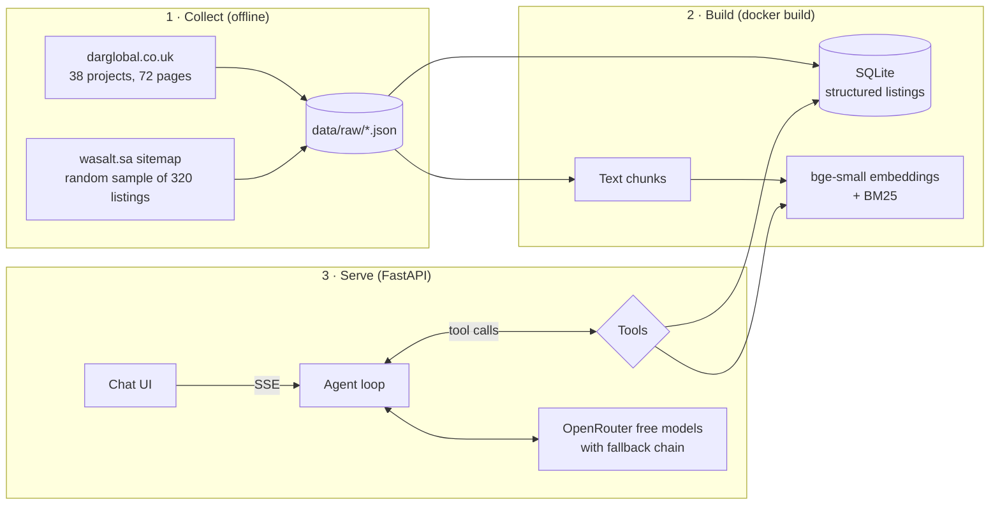

# DarGlobal Property Assistant: an agentic chatbot over Dar Global & Wasalt data

[](https://github.com/Aalamansari/DarGlobal-AI-Chatbot/actions/workflows/ci.yml)

A tool-using AI agent that answers questions about **Dar Global's international luxury developments** and **Wasalt's Saudi property listings**. It cites a source link for every claim, works in English and Arabic, and runs on free OpenRouter models.

**Live demo:** https://darglobal-property-assistant-hztg.onrender.com/

> Hosted on Render's free plan: if nobody has used it for 15 minutes, the first load takes about a minute while the server wakes up.

Try:
- *Which Dar Global projects are in Oman?*
- *3-bedroom apartments for sale in Riyadh under 1M SAR*
- *Compare median villa prices across Saudi cities*
- *Which Dar Global developments are branded with luxury partners?*
- *أرخص الشقق للإيجار في جدة*

## Architecture



### Why it is built this way

| Decision | Reason |
|---|---|
| **Agent with tools rather than plain RAG** | "3-bed under 1M in Riyadh" is a filter query, and vector search is poor at numbers. The model chooses between structured SQL search, market statistics and semantic search, and can chain several calls. |
| **Two stores** | Listings (price, beds, city) go in SQLite. Free text (project pages, FAQs, descriptions) goes in a hybrid BM25 + embedding index merged with reciprocal rank fusion. BM25 catches exact names like "Les Vagues"; embeddings catch meaning and Arabic. |
| **Small local embeddings** (`bge-small-en-v1.5`, quantised ONNX through fastembed) | No paid API, and it fits a free 512 MB instance. Corpus embeddings are computed at image build time. Arabic questions still work because the LLM writes tool arguments in English and BM25 indexes Arabic tokens. |
| **Plain agent loop, no framework** | A single agent with five tools doesn't need a graph framework. The loop is short, every step is easy to trace, and the UI shows each tool call live. I'd move to LangGraph for multi-agent hand-offs, human approval steps, or durable state that survives restarts. |
| **Model fallback + circuit breaker** | Free models get rate-limited upstream. The agent falls through a list of free tool-calling models and skips a failed model for 90 s. |
| **Answer cache + per-IP rate limit** | Free-tier quotas are small, so repeated questions are answered from cache. |
| **Snapshot, not live scraping** | Answers are fast and reproducible, and the app adds no load to the source sites. Re-running collection refreshes the data. |

### Tools the agent can call

| Tool | Backed by | Use |
|---|---|---|
| `search_listings` | SQLite | Filter Wasalt listings by purpose, city, district, type, price, bedrooms, area |
| `get_listing` | SQLite | Full details of one listing |
| `market_stats` | SQLite | Median, min and max price and price per m², grouped by city, district or type |
| `list_darglobal_projects` | JSON | Dar Global projects by country or keyword (partner brand, type) |
| `search_knowledge` | BM25 + vectors | Open questions over project pages, partners, FAQs, press and listing descriptions |

## Data collection

| Source | What | How |
|---|---|---|
| darglobal.co.uk | 38 projects (name, location, country, type, bedrooms, completion) + 72 pages (projects, partners, about, FAQ, press) | Structured project data read from each page's embedded Next.js JSON, plus page text |
| wasalt.sa | 320 listings (227 sale, 93 rent) across 20 cities + home/corporate pages | Random sample of URLs from Wasalt's public sitemap; fields read from schema.org JSON-LD and page data |

The collection scripts and the processing step are in [`scraper/`](scraper/). [scraper/README.md](scraper/README.md) explains how they work and how to re-run them.

Responsible collection:
- Only paths that robots.txt allows. Wasalt's `/search` is disallowed and was not touched.
- Low request rates (about one page every 1.2–1.5 s) and a small sample.
- Both sites put a bot check in front of automated clients, and **nothing here bypasses it**. Pages were read through a normal browser session.
- **No personal data is stored.** Agent and broker names and phone numbers are dropped; only company or agency names are kept.

Data snapshot: **19 Nov 2026**. Wasalt figures come from a sample and are not market-wide statistics, and the assistant says so in its answers.

## Run locally

```bash
cp .env.example .env               # add your OPENROUTER_API_KEY
docker build -t darglobal-property-assistant .
docker run -p 7860:7860 --env-file .env darglobal-property-assistant
# open http://localhost:7860
```

Without Docker: `pip install -r requirements.txt && python -m scripts.build_index && uvicorn app.backend.main:app --port 7860`

## Guardrails

| Layer | Guardrail |
|---|---|
| Input | Questions are limited to 1,000 characters and 8 requests per minute per IP. Common prompt-injection phrases ("ignore previous instructions", "system prompt", "jailbreak"...) are refused before the model is called, which also saves quota. |
| Prompt | The assistant only helps with real estate, treats tool results and page text as data rather than instructions, refuses to change its rules or reveal its prompt, and never invents facts or URLs. |
| Tools | Parameterised SQL, an allow-list for `group_by`, results capped at 10, tool errors caught, tool output truncated. |
| Output | Every markdown link in the answer is checked against the URLs the tools actually returned, and unknown links are reduced to plain text. The UI sanitises the answer's HTML with DOMPurify. |
| Agent loop | At most 6 tool rounds, limited history, capped answer length, low temperature. |
| Data | No personal data is stored. |

## Observability

Each question is one **agent run**, traced end to end with [Langfuse](https://langfuse.com):

```
property-agent (agent)                 question -> final answer, outcome, model, tools
├── input-guardrail (guardrail)        blocked: true/false
├── llm-call (generation)              messages in, tool calls out, model, token usage, latency
│     failed attempts are marked ERROR, so model fallbacks are visible
├── search_listings (tool)             arguments -> results
├── llm-call (generation)
└── link-guardrail (guardrail)         links removed from the answer
```

- **User feedback:** 👍/👎 on every answer is saved as a `user_feedback` score on that run's trace, so bad answers can be filtered and reviewed.
- **Metrics:** `GET /api/metrics` returns live counters: runs, answers, errors, cached answers, rate-limited requests, guardrail blocks, links removed, model fallbacks, token usage, tool and model usage, average and p95 latency, and feedback counts.
- **Structured logs:** one JSON line per run (`event: agent_run`) with the trace id, outcome, model, tools, steps, tokens and latency, which makes the Render logs searchable.
- **Optional:** tracing turns on when `LANGFUSE_PUBLIC_KEY` and `LANGFUSE_SECRET_KEY` are set. Without them the app runs the same, and metrics and logs still work.

## Testing

```bash
pip install -r requirements.txt -r requirements-dev.txt
pytest          # 32 tests, about 7 s, no API key needed
ruff check .
```

The unit and API tests replace OpenRouter with a fake model, so they are fast, free and give the same result every run. They cover:
- **Data cleaning:** property type, location and area parsing, text chunking, project clean-up
- **Tools:** every filter, exact bedroom counts, sorting and the result cap, SQL-injection attempts, market stats
- **Guardrails:** blocked phrases, Arabic and normal questions passing through, link removal
- **Agent and API:** a tool call followed by an answer (and the tool result sent back to the model), model fallback, all models failing, blocked questions never reaching the model, caching, input validation, rate limiting, feedback and metrics

**CI** ([.github/workflows/ci.yml](.github/workflows/ci.yml)) runs lint, builds the index and runs the tests on every push, then builds the Docker image and checks that the container responds on `/health`.

## Evaluation

`python eval/run_eval.py [base_url]` runs end-to-end cases. Each one checks that the right tool was chosen, that the expected facts appear in the answer, and that forbidden content does not. The cases cover structured search, statistics, Dar Global lookup, an Arabic query, and guardrail cases: off-topic requests (weather, coding), a prompt-extraction attempt and a role-change attempt. Run only the guardrail cases with `python eval/run_eval.py http://localhost:7860 guardrails`.

## Project layout

```
app/
  backend/
    main.py        FastAPI: SSE chat endpoint, cache, rate limit
    agent.py       tool-calling loop, model fallback, circuit breaker
    prompts.py     system prompt
    guardrails.py  input check, link check
    observability.py  Langfuse traces, metrics, structured logs
    tools.py       5 tools + JSON schemas
    retrieval.py   BM25 + embeddings, reciprocal rank fusion
    data.py        normalisation, SQLite, chunking
    config.py      settings and paths
  web/
    static/        single-file chat UI
data/raw/        scraped snapshot (JSON)
scraper/         collection scripts (browser) + process.py
scripts/         build_index.py (runs during docker build)
tests/           pytest unit and API tests (fake model)
eval/            end-to-end eval against a running server
.github/         CI: lint, tests, Docker build + health check
```

## Limitations and assumptions

- **Snapshot data:** collected on 19 Nov 2026 and not refreshed automatically. Wasalt data is a 320-listing sample (out of about 60,000), so counts and medians describe the sample, not the market.
- **Free models:** they are slower (5–20 s per answer) and rate-limited, with a small daily quota on a free OpenRouter key. The fallback chain and answer cache reduce the impact but can't remove it.
- **Single instance:** the cache, rate limits and metrics live in memory, so they reset on restart and aren't shared between instances. The production fix is Redis.
- **Free hosting:** Render's free instance sleeps after 15 minutes without traffic, so the first request after that takes about a minute.
- **English embeddings:** the vector index is English-only, chosen to fit in 512 MB. Arabic questions work because the model writes search arguments in English and BM25 indexes Arabic words.

## What I'd do next in production

- Scheduled re-collection (daily diff of the sitemap) with change tracking and stale-listing removal
- Postgres + pgvector instead of in-memory stores; a geo-search tool using listing coordinates
- A paid or self-hosted model for reliability, and streaming tokens
- Alerts on error rate, fallback rate and p95 latency; Langfuse datasets built from 👎 traces, fed back into the eval set
- A larger eval set with LLM-as-judge for faithfulness, run in CI
- Lead capture: hand off to a sales agent or CRM when a user shows buying intent
- Keep chat history on the server (per session) instead of trusting the history the browser sends, so it can't be faked
- Rate limit per signed session or with the platform's trusted client IP, since `X-Forwarded-For` can be spoofed
- An LLM-based classifier for injection and off-topic requests instead of a phrase list, plus a moderation check on outputs

_Built as a technical assignment. Not affiliated with Dar Global or Wasalt; all data is publicly available and may be out of date._
